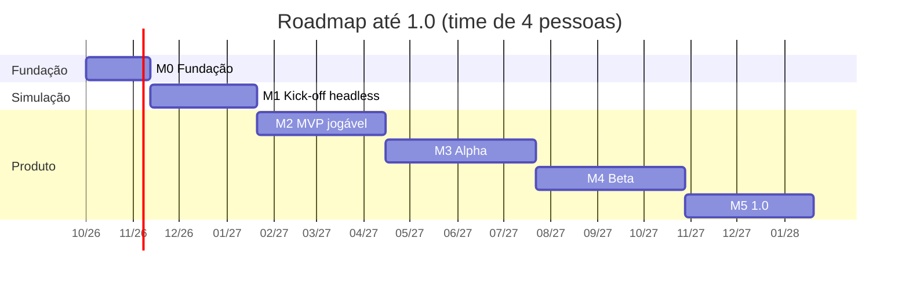
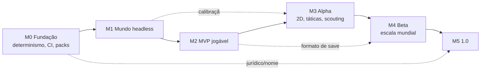

# 07 — Roadmap, equipe e custo

Estimativas em **semanas-pessoa**, para um time de referência de **4 pessoas**
(2 Rust/simulação, 1 Flutter/UI, 1 dados+game design, com QA distribuído). A coluna
"solo" mostra o mesmo escopo em regime de hobby (~12 h/semana).

---

## 1. Linha do tempo

| Marco | Duração | Semanas-pessoa | Solo (~12h/sem) | Portão de saída |
|---|---|---|---|---|
| M0 | 6 sem | 18 | ~4 meses | CI verde nas 3 plataformas + ADRs aprovadas |
| M1 | 10 sem | 38 | ~7 meses | Temporada headless com calibração dentro da tolerância |
| M2 | 12 sem | 46 | ~9 meses | **Critério de MVP** de [`00`](00-escopo.md#7-mvp--a-menor-coisa-que-prova-a-tese) |
| M3 | 14 sem | 54 | ~10 meses | 10 temporadas estáveis; torneio anti-exploit verde |
| M4 | 14 sem | 54 | ~10 meses | 40 países dentro dos orçamentos de performance |
| M5 | 12 sem | 44 | ~8 meses | Checklist de publicação de [`05`](05-dados-e-legal.md#8-checklist-antes-de-qualquer-publicação) |
| **Total** | **68 sem** | **254** | **~4 anos** | ≈ **16 meses** com 4 pessoas |

Os números de "solo" existem para deixar explícito: **em regime de hobby individual, o
escopo de 1.0 é irreal**. Nesse cenário, o alvo honesto é parar no M3 e tratar M4/M5 como
trabalho da comunidade.

---

## 2. Detalhe por marco

### M0 — Fundação (6 semanas)

**Objetivo:** tornar todo o resto mensurável.

* Workspace Rust + app Flutter + ponte funcionando com um `dispatch` trivial
* CI: `fmt`, `clippy -D warnings`, testes, build Windows/Android/iOS
* RNG determinístico, tipos de ponto fixo, `GameDate`, ids densos
* Carregador de data pack + validador + 1 país de exemplo (2 divisões)
* ADRs 0001–0004 aprovadas; nome do produto verificado (busca de marca)
* Harness de benchmark com orçamentos já falhando em vermelho (metas de RNF)

**Portão:** `managerfc-cli pack validate` e `managerfc-cli bench` rodando nas 3 plataformas em CI.

### M1 — Kick-off headless (10 semanas)

**Objetivo:** um mundo que gira sozinho, sem uma única tela.

* Motor v0 (estatístico) com contrato `MatchEvent` completo
* Calendário, temporada, tabela, copa, promoção/rebaixamento
* Progressão de jogadores (CA/PA, idade, condição), lesões simples, suspensões
* IA de escalação e primeira IA de mercado
* `calibrate` emitindo CSV; primeiras tolerâncias em CI
* Golden masters congelados

**Portão:** 20 temporadas seguidas sem divergência entre plataformas e com métricas de
[`04`](04-motor-de-partida.md#41-alvos-futebol-europeu-de-primeira-divisão-médias-recentes) dentro da tolerância.

> **Estado de implementação do próprio portão:** as duas metades já são
> verificadas de verdade, mas por testes separados — `golden verify` (`docs/08
> §3`) cobre "sem divergência entre plataformas" (3 temporadas, nas 3 famílias
> de SO da CI) e `calibrate --check` (`docs/04 §4.2`) cobre "métricas dentro
> da tolerância" (50 temporadas) — nenhum dos dois roda 20 temporadas pela
> fronteira real de carreira (`app::GameSession`: mercado, lesões, condição,
> progressão, copa e liga, todos juntos). `app::session::tests::vinte_temporadas_seguidas_nao_travam_e_preservam_os_invariantes_do_mundo`
> (novo) fecha essa lacuna: roda exatamente as 20 temporadas do portão pela
> fronteira completa e confere que nada degenera silenciosamente ao longo do
> caminho — dinheiro sempre conservado, CA nunca passa do potencial, elenco
> nunca cresce/encolhe, ligas nunca desbalanceiam, copa sempre produz um
> campeão. Não é o mesmo que "golden verify a 20 temporadas" (isso exigiria
> gravar um golden master de 20 temporadas, bem mais caro de manter do que as
> 3 atuais) — é a prova de que o mundo *aguenta* 20 temporadas, não de que o
> resultado bate byte a byte entre plataformas nessa duração.

> **Estado de implementação:** o crate `world` já faz o essencial deste marco
> para uma competição de exemplo — calendário (`rules::round_robin`), tabela
> com desempate (`rules::compute_table`) e promoção/rebaixamento entre
> temporadas, tudo consumindo o motor (v0.5 agora — ver `docs/04`, finalização
> vs. goleiro decide conversão, não só a força bruta) e testado com
> `world::run_seasons` contra o pack de exemplo do M0. `managerfc-cli
> calibrate` já roda e imprime as 5 métricas mensuráveis (gols/partida, %
> de vitória do mandante, % de empate, finalizações/time, % de conversão)
> contra os alvos de `docs/04 §4.1`, com `--check` (falha se alguma sair
> da tolerância — é o item "primeiras tolerâncias em CI" deste marco,
> agora real no job `cli-gate`) e `--csv` (acrescenta uma linha por
> rodada). Números contra o pack de exemplo, 200 temporadas: ~2,65
> gols/partida, ~44% de vitórias do mandante, ~12,5 finalizações/time,
> ~10,5% de conversão — todas dentro da tolerância, não mais na borda:
> `HOME_ADVANTAGE` (motor) foi recalibrado de 1,4 para 1,25 depois que
> `--check` expôs que o valor herdado do v0 deixava o mandante fora da
> faixa com o motor v0.5 (`docs/04 §4.1`, nota de implementação). `pack` agora também
> carrega `people/*.json` (`docs/03 §3`/`§7`) —
> jogadores de verdade, com atributos e CA/PA — e `world::strength_from_squad`
> usa a média de CA do elenco declarado como força do clube, com o sorteio
> sintético (`world::strength`) só de *fallback* para clubes sem elenco; o
> pack de exemplo (`packs/core/example-two-tier/people/`) já tem 16
> jogadores por clube, gerados por um script placeholder
> (`tools/generate_people.py`, **não** o pipeline de dados real de
> `docs/05 §3.3`). **Progressão de jogadores por idade** (`docs/03 §5.1`)
> também já é real dentro de uma sessão: `world::progression` mantém um
> `PlayerState` (CA + idade) por jogador, separado do pack imutável,
> envelhece 1 ano e ajusta CA a cada `AdvanceSeason` segundo a faixa etária
> (ganho alto até 18, platô 24-28, declínio acelerado 33+ — sinal e direção
> verificados por teste, não a curva exata), e `app::GameSession` já
> recalcula a força de cada clube a partir desse estado a cada temporada —
> não é decorativo, uma sessão de 5+ temporadas muda de força mensurável.
> Simplificação aceita: "uma temporada = um ano" (sem calendário mensal
> ligado a `world` ainda) e nenhuma das outras variáveis da fórmula
> completa (treino, minutos jogados, profissionalismo, moral — nenhuma
> existe). **IA de escalação** (`docs/01 §2.4`) também já é real: o crate
> `ai` (antes um esqueleto vazio) ganhou `ai::select_starting_eleven` —
> escolhe os 11 titulares por posição e CA numa formação fixa (1 GK, 4 DF,
> 4 MF, 2 FW) — e `world::strength_from_squad`/`strength_from_roster` agora
> calculam a força do clube pela média dos **titulares**, não do elenco
> inteiro; um reserva fraco não arrasta mais a força pra baixo (pego por
> teste dedicado, `strength_from_squad_ignora_reservas_fracos_fora_da_escalacao`).
> A dependência segue a direção documentada em `docs/02 §2`: `ai` só
> depende de `domain`, é `world` quem depende de `ai`, não o contrário.
> **Lesões simples** também já são reais: `world::roll_injuries` sorteia,
> uma vez por temporada e por jogador (~6%, fatia mínima de RF-JG-08,
> `docs/01 §2.3`), se ele fica fora de combate a temporada inteira —
> `strength_from_roster`/`profile_from_roster` excluem jogador machucado
> do cálculo de força/qualidade (nunca é candidato a titular), e ele
> recupera sozinho se não for sorteado de novo. Confirmado por teste que
> lesões de fato acontecem em 5 temporadas no pack de exemplo (256
> jogadores) e que `CommandReceipt::injuries` bate com o roster. **Golden
> masters** também já são reais: `managerfc-cli golden record`/`golden
> verify` (`docs/08 §3`) gravam/conferem um `state_hash` (FNV-1a) sobre as
> tabelas finais e os totais agregados de uma `app::GameSession`; um
> arquivo de referência (`core/tests/golden/s42.json`) está commitado e é
> verificado no job `cli-gate` nas três famílias de SO da matriz de CI —
> isso **é** o cartão de desempenho de CI cross-platform citado em `docs/08
> §8`, cobrindo a fatia de hash de estado entre plataformas. Escopo ainda
> fora: hash **por dia** (sem calendário diário em `world`), artilheiros
> (`MatchEvent::Goal` não carrega autor) e distribuição de CA (nenhum
> `app::Query` expõe isso). **Copa** também já é real:
> `pack::Format::Knockout` + `world::cup` simulam mata-mata de fase única
> (sem sorteio de chave, pareamento fixo por `ClubId` — `rules::pair_round`)
> com participantes = todos os clubes do país da competição (não uma
> inscrição própria: nenhum clube aponta `competition` pra uma copa).
> Escopo bem mais estreito que RF-MU-03 completo (`docs/01 §2.1`): um jogo
> só por confronto (sem replay, sem ida-e-volta, sem gol fora), empate no
> tempo normal resolvido por sorteio de moeda 50/50 em vez de prorrogação
> simulada. Partidas de copa não entram nas contagens de calibração de liga
> (`docs/04 §4.1`) — confirmado por teste que os números de `calibrate` não
> mudam nem um dígito com a copa ligada. O pack de exemplo ganhou uma copa
> de 16 times (`es.cup`, as duas divisões inteiras); `managerfc-cli play` e
> `app::Query::CupChampion` mostram o campeão. **Condição física** também
> já é real: `world::condition::apply_season_fatigue` recalcula a condição
> de entrada de cada jogador na temporada seguinte a partir de quantas
> partidas de liga ele titularizou na que acabou de terminar (não
> cumulativo entre temporadas, piso de 70% mesmo pro titular mais usado —
> sem calendário diário não dá pra calcular frescor real dia a dia, mesma
> limitação documentada em `world::progression`). Entra como multiplicador
> na força efetiva do titular (`world::quality::build_profile`), não na
> escolha de quem joga (a escalação ainda ignora cansaço, RF-PA-01
> completo com rotação é M3). `CommandReceipt::tired_players` e
> `managerfc-cli play` já reportam quantos jogadores entram cansados —
> confirmado por teste que, no pack de exemplo, a maioria dos 176 titulares
> (16 clubes × 11) sai da primeira temporada com condição reduzida.
> **Suspensões** (RF-JG-09) também já são reais, e foram o motivo de uma
> mudança estrutural maior: `world::season::run_season` agora simula toda
> liga **rodada a rodada** no caminho de carreira (perfil de cada clube
> recalculado a cada rodada a partir do roster, não mais uma vez por
> temporada) — sem essa granularidade, "suspenso só na próxima rodada" não
> teria onde ter efeito. Depois de cada rodada, `world::discipline` sorteia
> ~4% de chance de expulsão por time (ordem de grandeza real de cartão
> vermelho); se acontece, um titular daquele time (sorteado entre os 11)
> fica fora da rodada seguinte da mesma competição — nunca atravessa
> temporada, sem cartão amarelo acumulado, sem reincidência. O caminho
> estático (`calibrate`/`bench`, sem roster) continua intacto: mesma
> simulação de antes, confirmado que os números de calibração não mudam
> nem um dígito. `CommandReceipt::suspensions` e `managerfc-cli play` já
> reportam quantas expulsões aconteceram; confirmado por teste que
> acontecem de fato em 10 temporadas no pack de exemplo. O que falta deste
> marco: **moral, fadiga acumulada de carreira, regens e aposentadoria**
> (só CA, idade, lesão sim/não e condição por temporada evoluem hoje), e
> **lesão com tipo/gravidade/prazo de recuperação** (RF-JG-08 completo é
> M3; aqui é só sim/não por temporada). Com suspensões, **o checklist de
> objetivos deste marco está completo** — o que resta são simplificações
> documentadas dentro de cada item, não itens inteiros faltando.
> **A "primeira IA de mercado"** também já é real:
> `ai::run_market_day` (subconjunto minúsculo de RF-TR-02/05, `docs/01
> §2.4` — ambos marcados M2 lá porque a versão completa pede negociação,
> disputa, reputação e contratos, nada disso existe) roda antes de cada
> temporada em `GameSession::dispatch`: cada clube tenta trocar seu titular
> mais fraco por um reserva melhor de outro clube que caiba no orçamento
> (`ai::market_value`, uma fórmula quadrática em CA só, não calibrada) —
> mecânico e automático, sem negociação nem recusa, o "dono" sempre vende
> se o preço bate. `domain::Money` (novo) e `world::finance` (orçamento
> sintético, pack ainda não declara finanças) sustentam isso; `PlayerState`
> ganhou `club`/`position` porque agora o clube de um jogador **muda** de
> temporada pra temporada, e `strength_from_roster` passou a agrupar
> elenco por `roster[i].club`, não mais por `pack.players_of` (o pack
> nunca muda; só o roster sabe quem pertence a quem *agora*). Confirmado
> por teste que pelo menos uma transferência acontece em 5 temporadas no
> pack de exemplo, e que dinheiro é conservado (nenhuma transferência cria
> ou destrói orçamento). A força de elenco também é uma simplificação
> deliberada de `docs/04 §2.1`: média simples de CA dos titulares, sem peso
> por tática/condição (essas dependem de tática completa, M3) — e a
> escalação em si não tem tática nenhuma (não sabe de marcação, zona,
> plano B) — e a posição do jogador é um único campo primário
> (`domain::Position`), não a familiaridade completa por posição de
> `docs/03 §3`. **O motor em si avançou de v0 para v0.5** (ver a nota
> completa em `docs/04`): `world::quality` calcula `FinishingQuality`/
> `GoalkeepingQuality` a partir dos 36 atributos visíveis dos titulares
> (não só CA), e `engine::simulate` resolve cada finalização num segundo
> sorteio contra o goleiro adversário — `MatchEvent::Shot` entra no
> contrato, finalizações/time e conversão viram métricas calibráveis pela
> primeira vez. Ainda sem zona, ângulo, pressão, clima ou tática de
> verdade — isso é v1/v2 (`docs/04 §7`).
### M2 — MVP jogável (12 semanas)

**Objetivo:** responder se o loop é divertido. Ver critérios em [`00`](00-escopo.md#7-mvp--a-menor-coisa-que-prova-a-tese).

* Shell de UI, navegação, `DataTable` virtualizada, design tokens
* Telas: início/caixa de entrada, elenco, jogador, tática, tabela, calendário, mercado
* Motor v1 (posse + eventos) e partida em modo texto ao vivo
* Transferências jogáveis, contratos, treino básico
* Save binário cross-platform + autosave + 3 slots
* Builds distribuíveis de Windows e Android

**Portão:** os 4 critérios de MVP. **Se o critério 1 (diversão) falhar, o projeto para
aqui e volta ao design** — é para isso que o marco existe.

> **Estado de implementação:** a fronteira `dispatch`/`query` do `app`
> (`docs/02 §4`) já existe e tem um consumidor externo real (`managerfc-cli
> play`). Save/autosave/slots também já têm uma primeira fatia real:
> `persist` grava/lê um save versionado com checksum e escrita atômica
> (`docs/03 §8.1`), `GameSession::save_to_path`/`load_from_path` cobrem o
> ciclo completo por replay determinístico, `app::slot_path`/`autosave_path`
> já fixam a convenção de nome para os 3 slots, e `managerfc-cli
> save`/`load` provam tudo isso de fora do crate (inclusive em CI,
> `cli-gate`, nas 3 plataformas). O que falta deste marco é majoritariamente
> o lado UI: gerar a ponte `flutter_rust_bridge` a partir da fronteira
> `app` e construir as telas em cima (incluindo a tela de "carregar/salvar"
> que de fato lista os 3 slots) — o que este ambiente de desenvolvimento
> não consegue fazer nem verificar por falta do SDK Flutter/Dart (ver
> `app/README.md`, o diretório Flutter, não `core/app`). Do lado Rust, o
> primeiro item deste marco já tem duas fatias reais, as duas pontas de
> RF-CL-02/03 (`docs/01 §2.2`): **folha salarial** (`world::pay_salaries`,
> despesa) e **bilheteria** (`world::finance::match_day_revenue`, receita).
> Folha: cada jogador custa ao clube por temporada, debitado antes do
> mercado rodar — a primeira despesa recorrente de verdade da economia do
> mundo (antes dela, orçamento só mudava por transferência, conservado
> entre clubes). Bilheteria: cada partida de liga em casa credita um
> público sintético de uma capacidade de estádio sintética vezes um preço
> de ingresso deliberadamente baixo — não realista, um parâmetro de
> balanceamento escolhido pra manter a bilheteria de uma temporada numa
> fração (≈45-50% no pack de exemplo) da folha, não maior. Juntas: dinheiro
> sai do sistema a cada temporada por folha, uma fração dele volta por
> bilheteria, e o total de `budgets` continua caindo ao longo de uma
> carreira — só mais devagar que só com folha (confirmado por teste).
> Ainda sem luvas, cláusula ou negociação de verdade (`RF-TR-03`/`04`):
> "transferências jogáveis" continua fora — o mercado é automático e
> mecânico (`ai`), sem nenhum ponto de decisão humana. Elenco jogável,
> treino e táticas também continuam faltando — nenhum dos três tem estado
> ainda para o save precisar guardar além do replay.
>
> A **duração** de RF-CL-02 também já é real: `world::ContractState`
> (`world::contract`) guarda, por jogador, temporadas restantes de
> contrato e o CA travado na última assinatura — sorteado entre 1 e 5 na
> criação da carreira, decrementado a cada temporada
> (`world::advance_contracts`), renovando automaticamente ao chegar a
> zero (nova duração, salário travado no CA pós-progressão) e também ao
> transferir (`world::run_market_day`, contrato novo de duração máxima no
> comprador). O efeito real: `world::pay_salaries` agora usa o CA
> travado, não o corrente — o salário de um jogador fica parado entre
> renovações mesmo que o CA suba, só reajustando quando o contrato de
> fato muda, como um contrato de verdade. Ainda sem agente livre
> (`RF-TR-07`, M3): um contrato aqui nunca termina sem renovar.
>
> Esse mesmo `ContractState` já alimenta `ai::market_value` (RF-TR-02,
> `docs/01 §2.4`): duração restante de contrato agora entra como desconto
> no valor de transferência — pouco contrato sobrando vale menos. Não é
> só cosmético: o desconto pode baixar o preço o suficiente pra caber no
> orçamento de um comprador que não conseguiria pagar o preço cheio,
> mudando o resultado real do mercado (`ai::run_market_day`), não só o
> número reportado. **Idade** (`world::PlayerState::age_years`) entrou do
> mesmo jeito: jovem carrega prêmio, veterano carrega desconto, pico é
> preço cheio — mesma mecânica de desconto de contrato, outra variável.
> **PA** (`domain::Ability::potential()`) também: margem de evolução
> ainda não realizada carrega prêmio especulativo. Efeito real confirmado
> por varredura de seeds (9 de 10 produziram resultado diferente ao
> ligar o fator de PA sobre o mesmo mundo, não decorativo). Reputação
> entrou depois (ver M2, abaixo) como quinta variável; demanda ainda
> falta do RF-TR-02 completo.
>
> **Reputação de clube** (RF-MU-08, `docs/01 §2.4`) também entrou — fatia
> de "receita" do requisito (ele cita "atratividade, receita e IA"; só
> receita por enquanto): `world::generate_club_reputation` (sintética,
> 0-100) empurra o piso de público de `match_day_revenue` pra cima quanto
> maior a reputação do mandante, nunca garantindo casa cheia. "Atratividade"
> e "IA" de RF-MU-08, e reputação de país (a outra metade do requisito),
> ainda faltam.
>
> **Premiação** (`world::finance::distribute_prize_money`) é a segunda
> fonte de receita real de RF-CL-03, ao lado da bilheteria: um pool fixo
> por competição de liga, por temporada, dividido por posição final na
> tabela (peso linear — campeão ganha mais, lanterna ganha menos). Pool
> pequeno de propósito (bem menor que a bilheteria da mesma competição),
> só liga (copa não tem tabela). `CommandReceipt::prize_money_paid`
> reporta o total por temporada; golden master bump 7→8
> (`total_prize_money_paid_cents`).
>
> **TV** (`world::finance::distribute_tv_revenue`) é a terceira fonte de
> receita real de RF-CL-03: outro pool fixo por competição de liga, por
> temporada, mesma ordem de grandeza da premiação — mas dividido por
> **reputação** (`world::generate_club_reputation`, peso reputação+1,
> nunca zero), não por posição na tabela, ao contrário da premiação: um
> clube reputado atrai audiência o ano inteiro, mesmo fora das primeiras
> colocações. Só liga, mesma exclusão de copa da premiação.
> `CommandReceipt::tv_revenue_paid` reporta o total por temporada; golden
> master bump 9→10 (`total_tv_revenue_paid_cents`).
>
> **Patrocínio** (`world::finance::pay_sponsorship`) fecha as fontes de
> receita de RF-CL-03: valor absoluto por clube (500,00 a 2.500,00 por
> temporada, linear na reputação), não um pool dividido como premiação e
> TV, e vale pra todo clube do pack, não só os de tabela de liga.
> `CommandReceipt::sponsorship_paid` reporta o total por temporada;
> golden master bump 10→11 (`total_sponsorship_paid_cents`). Como o
> orçamento alimenta o mercado, o dinheiro extra muda transferências e
> folha de temporadas seguintes, não só o saldo (visível no `play`).
>
> **Dívida** (`world::finance::repay_debt`) fecha o lado de
> despesa/saldo de RF-CL-03: `world::pay_salaries` passou a registrar o
> que não cabe no caixa como passivo por clube em vez de só descartar;
> `repay_debt` desconta isso automaticamente no início da temporada
> seguinte, antes de qualquer outro gasto (inclusive a própria folha
> daquela temporada) — sem juros, sem prazo. Confirmado no caminho de
> carreira de verdade, não só em teste isolado: `managerfc-cli play
> --seasons 5 --seed 42` mostra dívida paga nas temporadas 4 e 5
> (15.077,35 e 135.885,17), não zero em toda temporada.
> `CommandReceipt::debt_repaid` reporta o total por temporada; golden
> master bump 8→9 (`total_debt_repaid_cents`).
>
> Enquanto testava premiação, um proptest achou uma quebra real de
> determinismo pré-existente em `rules::compute_table` (`ADR 0002`):
> quando 3+ clubes empatam em todos os critérios configurados antes de
> `HeadToHead`, esse critério pode ser não-transitivo por natureza (A > B
> > C > A, documentado desde sempre na função) — o bug era que, nesse
> caso raro, a tabela final dependia de como `HashMap::into_values()`
> calhava de iterar internamente, não-determinístico entre execuções da
> mesma entrada. Corrigido pré-ordenando por `ClubId` antes do sort real
> (`table.sort_by_key(|row| row.club)`), o que fixa a ordem de entrada e
> torna o resultado sempre o mesmo — não resolve o ciclo de verdade
> (impossível), só garante que a mesma entrada nunca produz tabelas
> diferentes. Teste de regressão dedicado em `rules::table` reproduz o
> ciclo de propósito e chama `compute_table` 50 vezes seguidas sobre a
> mesma entrada.
>
> **Reputação do clube vendedor** entrou em `ai::market_value` como
> quinta variável de preço (RF-TR-02, `docs/01 §2.4`) — jogador de um
> clube mais reputado custa mais, mesmo com CA/idade/PA idênticos a um
> de clube sem nome. Complementa (não substitui) a recusa de ambição:
> um papel é preço, o outro é candidatura, independentes. `market_value`
> mudou de "multiplica os quatro fatores de permilagem, divide por
> 10^9" para dividir progressivamente a cada fator — com CA até 255 e
> agora cinco fatores de até ~1600 cada, a multiplicação acumulada antes
> de uma única divisão passaria de `i64::MAX`. Só demanda falta do
> RF-TR-02 completo.
>
> **RF-JG-02** (atributos ocultos, `docs/01 §2.3`) ganhou suas oito
> fatias reais — todo o requisito agora tem pelo menos um efeito real em
> jogo, nenhum calibrado ainda:
> `world::generate_injury_proneness` sorteia uma
> **propensão a lesão** sintética (0-100) por jogador, uma vez por
> carreira, e `world::roll_injuries` passa a variar a chance de lesão por
> ela (2% a 10%, antes fixa em 6% pra todo mundo — propensão média
> reproduz exatamente os 6% de antes, a taxa agregada não mudou).
> `world::generate_professionalism` sorteia **profissionalismo** (0-100)
> do mesmo jeito, e `world::advance_season` passa a somar um bônus de
> evolução (0 a +2) proporcional a ele sobre a curva de idade/minutos
> jogados — profissional evolui melhor e declina mais devagar.
> `world::generate_loyalty` sorteia **lealdade** (0-100), e
> `ai::run_market_day` (RF-TR-05) passa a nunca considerar candidato a
> saída quem tem lealdade acima de um limiar fixo (80), mesmo com o preço
> batendo — efeito real: `managerfc-cli play` já mostra temporadas com
> menos transferências (até zero) por causa disso.
> `world::generate_dirtiness` sorteia **sujeira** (0-100) do mesmo jeito,
> e `world::roll_suspensions` (RF-JG-09) passa a pesar o sorteio de quem é
> expulso dentro dos titulares a favor de quem é mais sujo (1x a 11x mais
> chance que o mais limpo), em vez de uniforme — a chance do time ser
> expulso continua fixa em ~4%, só "quem" muda.
> `world::generate_big_game_mentality` sorteia **jogo importante** (0-100)
> do mesmo jeito, e `world::apply_big_game_bonus` escala a força de cada
> clube só na copa (0,9x a 1,1x conforme a média dos titulares) antes de
> cada confronto de mata-mata — a liga nunca é afetada, e o caminho
> estático de `calibrate`/`bench` continua usando a força bruta.
> `world::generate_consistency` sorteia **consistência** (0-100) do mesmo
> jeito, e `world::apply_consistency_swing` balança a força de cada clube
> a cada rodada de liga (ruído zero-médio: ±0% com consistência 100 a
> ±20% com consistência 0) — ao contrário de sujeira/jogo importante,
> não direciona nada, só aumenta a variância de time inconsistente; sem
> efeito em copa (sem granularidade de rodada lá) nem no caminho
> estático. `world::generate_ambition` sorteia **ambição** (0-100) do
> mesmo jeito, e `ai::run_market_day` (RF-TR-05) passa a recusar uma
> transferência pra um clube de reputação menor que a do vendedor quando
> o jogador é muito ambicioso, mesmo com preço e lealdade batendo —
> reputação de clube entra no mercado pela primeira vez, só como filtro
> de candidatura (na época, `RF-TR-02` completo ainda não usava
> reputação no preço em si — passou a usar pouco depois, ver
> `ai::market_value` abaixo). `world::generate_adaptation` sorteia
> **adaptação** (0-100) do
> mesmo jeito, e `world::apply_adaptation_penalty` reduz a força de um
> titular recém-transferido (até -15%, decaindo por até duas temporadas)
> — malus puro, some depois da janela, adaptação máxima nunca sofre
> nada. É o único atributo com estado de carreira próprio (`world::
> initial_seasons_since_transfer`/`mark_transferred`/
> `advance_seasons_since_transfer`): "quantas temporadas desde a última
> transferência" muda durante o jogo, ao contrário de todo sorteio
> fixo-por-carreira anterior.
>
> `world::morale` cobre uma fatia mínima de "moral" de RF-JG-07
> (`docs/01 §2.1`, ao lado da condição física que já existia) — por
> **clube**, não por jogador: `apply_morale` escala a força de cada
> clube conforme o saldo de vitórias/derrotas nas últimas 3 partidas de
> liga já disputadas na temporada (empate neutro), antes de simular
> qualquer partida da rodada atual — sequência de vitórias anima,
> sequência de derrotas abate. Função pura (sem RNG, só lê
> `RoundRobinOutcome::results` acumulado), e por isso o único atributo de
> `world::season` que não precisou de nenhum wiring em
> `app::GameSession` (nem geração, nem estado de carreira). Mesma
> exclusão de granularidade de rodada que sujeira/jogo importante/
> consistência/adaptação: só liga, só caminho de carreira.
>
> `world::progression` também avançou dentro de RF-JG-05 (`docs/01 §2.3`):
> além de idade (M1), `advance_season` agora recebe a escalação titular da
> temporada (o mesmo conjunto que `world::condition` já usa pra fadiga) e
> dá um pequeno bônus de evolução (+0 a +3, nunca negativo) a quem jogou —
> reserva mantém a curva de idade pura. É a fatia de "minutos jogados" da
> fórmula completa (`docs/03 §5.1`); treino, moral e qualidade do clube
> continuam fora (profissionalismo, acima, já não).
>
> `world`/`rules`/`engine`/`pack`/`persist` seguem adiantados em relação à
> UI — o próximo passo de maior risco continua sendo essa ponte, não mais
> lógica de núcleo.

#### Plano de fechamento do M2 (lado Rust)

Diagnóstico: o núcleo é profundo em economia e raso em **agência do
técnico** — `app` só tem `AdvanceSeason` e 4 consultas; não há clube do
usuário, avanço por rodada, escalação, decisão de mercado, nem log de
comandos no save (guardava só `seasons_advanced`, até a F1); o motor v0 é estatístico,
sem jogadores em campo. Parar de refinar economia e construir jogabilidade,
nesta ordem (dependência e risco, cada fase = 1+ commits com pipeline
completo e golden como rede de segurança):

| Fase | Entrega | Por que nessa ordem |
|---|---|---|
| F0 | Medir em escala MVP (48 clubes, ~1.500 jogadores): tempo de temporada e RAM vs. critério MVP #2 e RNF-02/08; otimizar hotspots | Arquitetura falha cara se descoberta tarde (`00 §7`) |
| F1 ✅ | Temporada resumível por rodada (`AdvanceRound`); `AdvanceSeason` vira loop; golden idêntico; save v2 com log de comandos | Maior refator; tudo abaixo depende dele |
| F2 ✅ | Clube do usuário + perfil do técnico (RF-CA-01); o save v2 já veio na F1; teste cross-platform fica pra F9 | Critério MVP #4 |
| F3 | Queries da UI: elenco, jogador, clube/finanças, calendário, última partida | A UI só enxerga o que `Query` expõe |
| F4 | Escalação/formação/instruções (RF-PA-01/02), penalidade fora de posição | Primeira decisão real |
| F5 | Partida ao vivo em texto, substituições, estatísticas (RF-PA-05/06/07) | Precisa de F1 + F4 |
| F6 | Mercado jogável: janelas, ofertas, negociação, demanda (RF-TR-01..04) | Precisa de F1 + F2 |
| F7 | Treino básico (RF-TC-01) + moral/fadiga por jogador (RF-JG-07) | MVP exige treino com efeito mensurável |
| F8 | Caixa de entrada (RF-CA-07) + cliente `manage` na CLI | Valida o loop sem Flutter |
| F9 | Gates automatizados dos critérios MVP 2-4, contrato `app` congelado pra ponte, linhas de corte | Fecha o marco |

**F0 medida** (`packs/tools/gen_scale_pack.py`, saída não versionada;
`managerfc-cli play --pack`, release, máquina de desenvolvimento): 48 clubes /
1.440 jogadores, 1 temporada = 23 ms, 20 temporadas = 0,35 s com pico de
9,9 MB de RSS; 64 clubes / 1.920 jogadores (pior caso, com copa — o
validador exige copa em potência de 2 usando todos os clubes do país, então
48 clubes ficam sem copa), 1 temporada = 44 ms, 20 = 0,68 s, 9,8 MB. Folga de
~200x sobre os 5 s de desktop do critério MVP #2 e de ~60x sobre os 600 MB
de RNF-08. Conclusão: nenhum gargalo a otimizar hoje; otimizar agora seria
prematuro. O trabalho de "otimização" é **proteger essa folga** — gate
automatizado de tempo/memória em F9 — porque F4-F7 vão encarecer cada
partida (jogadores em campo, estatísticas, eventos narrados).

**F1 feita:** `world::SeasonRun` joga a temporada uma rodada por vez
(`start` → `play_matchday` → `finish`; `run_season` com carreira é só esse
laço), `app::Command::AdvanceRound` + `Query::SeasonProgress`, e
`AdvanceSeason` virou "`AdvanceRound` até acabar" — o recibo é a soma dos
recibos das rodadas (testado). Rede de segurança cumprida: golden master
(`8cf19d44332c5e61`) e `calibrate` byte-idênticos sem regravar; ligas rodam
em paralelo por rodada, o que é seguro porque não compartilham estado.
Save v2 (`persist::SCHEMA_VERSION` 1→2): `seasons_advanced` virou
`command_log` (1 byte por comando, codificado por `app`); um save feito no
meio da temporada reabre no mesmo ponto (testado). Pré-temporada
(dívida/folha/mercado/lesões) vem no recibo da 1ª rodada, fechamento
(acesso/queda, copa, premiação, TV, patrocínio, fadiga, progressão,
contratos) no da última.

**F2 feita:** `Command::TakeClub { club, coach }` (uma vez, antes da
primeira rodada; valida clube, nome, nacionalidade e reputação) +
`CoachProfile` (nome, nacionalidade, reputação — "experiência prévia" de
RF-CA-01 fica fora, sem consumidor) + `Query::Manager`. Comandos agora têm
payload variável no log (`app::command`: tag + campos little-endian, tags
imutáveis, `decode` nunca panica — proptest). Sem `TakeClub` a sessão é só
observadora (headless/golden/calibrate). Nada consome o clube assumido
ainda, e isso é testado: o mundo é idêntico com e sem `TakeClub` — as
fases F4-F6 passam a respeitá-lo (a IA deixa de decidir pelo clube).

Linhas de corte deliberadas (o MVP tem **1 país**, `00 §7`): RF-MU-09 (ligas
em segundo plano) vai para o M4 junto com múltiplos países; RF-JG-04
(familiaridade posicional) entra só como penalidade fora de posição;
RF-MU-08 "atratividade/IA" e saldo negativo de RF-CL-03 ficam fora. Segue
bloqueado neste ambiente, sem SDK: UI Flutter, ponte, builds Windows/Android
e o critério MVP #1 (10 testadores).

### M3 — Alpha (14 semanas)

* Motor v2: regime assistido, posições, **visão 2D**, bolas paradas, fadiga intra-jogo
* Táticas completas (instruções por jogador, marcação individual, planos alternativos)
* Treino detalhado + comissão técnica
* Scouting com névoa de guerra e rede de olheiros
* Regens, aposentadoria, evolução calibrada em 10 temporadas
* Diretoria, metas, demissão, busca de emprego
* Build iOS via TestFlight; primeiro teste fechado (~50 pessoas)

**Portão:** 10 temporadas com distribuição de CA estável (±10%) e torneio anti-exploit
sem tática acima de 62% de aproveitamento.

### M4 — Beta (14 semanas)

* 40+ países, 100+ divisões, competições continentais, seleções
* Base completa (~250k jogadores) dentro dos orçamentos de RNF-02/04/08 **no mobile**
* Editor pré-jogo (desktop) + import/export CSV/JSON
* Economia de longo prazo (inflação de mercado em 20 temporadas)
* Imprensa, conversas com elenco, empréstimos, pré-contratos
* Beta aberto; instrumentação opt-in para balanceamento

**Portão:** orçamentos de performance verdes no aparelho mobile de referência com base
completa carregada.

### M5 — 1.0 (12 semanas)

* Modding: múltiplos packs, packs cosméticos, documentação do formato
* Localização PT-BR/EN/ES completa; acessibilidade (RF-PL-07)
* Polimento: atalhos, estados vazios, mensagens de erro, primeira sessão
* Empacotamento: MSIX, AAB, IPA; páginas de loja; checklist jurídico
* Estabilização: 2 semanas de *bug bash* sem features novas

**Portão:** checklist de publicação de [`05`](05-dados-e-legal.md#8-checklist-antes-de-qualquer-publicação) completo.

---

## 3. Pós-1.0 (não comprometido)

Ordem sugerida por relação valor/custo: hot-seat local → estatísticas históricas
avançadas → modo desafio/cenários → mais idiomas → pesos do motor refinados com dados
abertos → build web (WASM) → avaliação de multiplayer.

---

## 4. Equipe

| Papel | Alocação | Responsabilidade |
|---|---|---|
| Eng. de simulação (Rust) × 2 | integral | Núcleo, motor, IA, performance, determinismo |
| Eng. de cliente (Flutter) × 1 | integral | UI, 2D, ponte, empacotamento |
| Dados + game design × 1 | integral | Pipeline de ratings, packs, calibração, balanceamento |
| QA / release | ~0,5 | Automação de testes, builds, testes em aparelhos |
| Jurídico (externo) | pontual | Revisão de marca e de dados antes do M5 |

Fator de ônibus: **nenhuma área pode ter dono único**. Rotação obrigatória de revisão de
PR entre núcleo e UI.

---

## 5. Custo indicativo

Cenário A — time contratado (referência Brasil, 16 meses):

| Item | Estimativa |
|---|---|
| 4 pessoas × 16 meses | principal custo do projeto |
| Aparelhos de teste (3 Android, 2 iOS, 1 PC de referência baixa) | R$ 15–25 mil |
| Conta Apple Developer (2 anos) + Google Play (único) | ~R$ 1,5 mil |
| Revisão jurídica de PI | R$ 8–20 mil |
| Infra (CI com runners macOS, armazenamento) | R$ 300–800/mês |
| Steam (opcional, pós-1.0) | US$ 100/produto |

Cenário B — comunidade aberta: custo direto cai para infraestrutura + jurídico
(R$ 10–25 mil no total), e o cronograma passa a depender de retenção de contribuidores —
que é o risco real, não o dinheiro (ver [`09`](09-riscos.md)).

---

## 6. Dependências entre marcos

Caminho crítico: **M0 → M1 → M2**. Tudo que não estiver nesse caminho (2D, imprensa,
editor, localização) é deliberadamente adiado — é a única forma de chegar cedo à pergunta
que importa: *o jogo é bom?*

---

## 7. Como o escopo é cortado sob pressão

Ordem de corte pré-acordada, para não virar discussão no meio do aperto:

1. Cortar **países** (40 → 12) — preserva a experiência, reduz dados e custo de calibração
2. Cortar **imprensa e conversas** (RF-CA-04/05)
3. Cortar **editor no jogo** (mantém CLI + edição de arquivos)
4. Cortar **iOS do 1.0** (Windows + Android primeiro)
5. Cortar **localização** para PT-BR + EN

Nunca cortáveis: determinismo, save cross-platform, calibração do motor, névoa de guerra.
São o que diferencia o produto e o que é caro demais para retrofitar.
